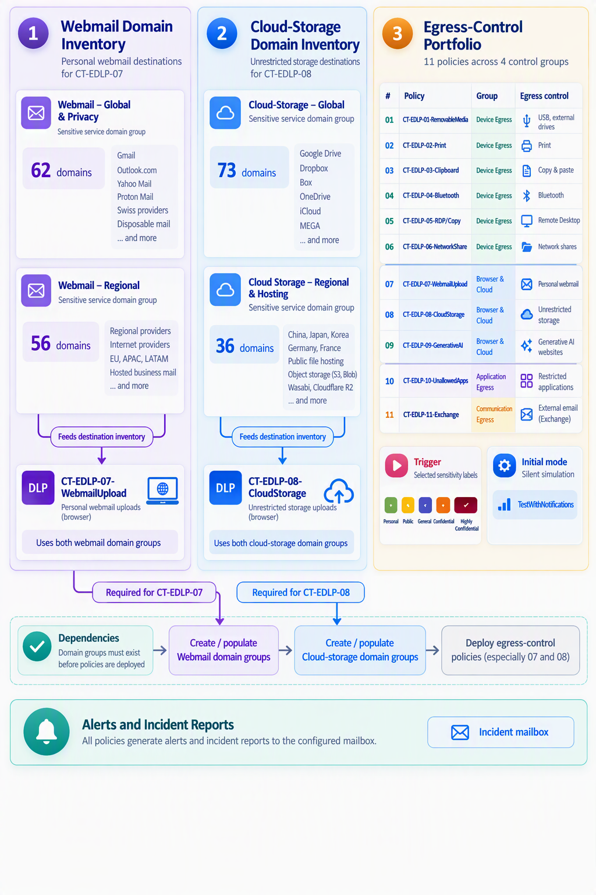
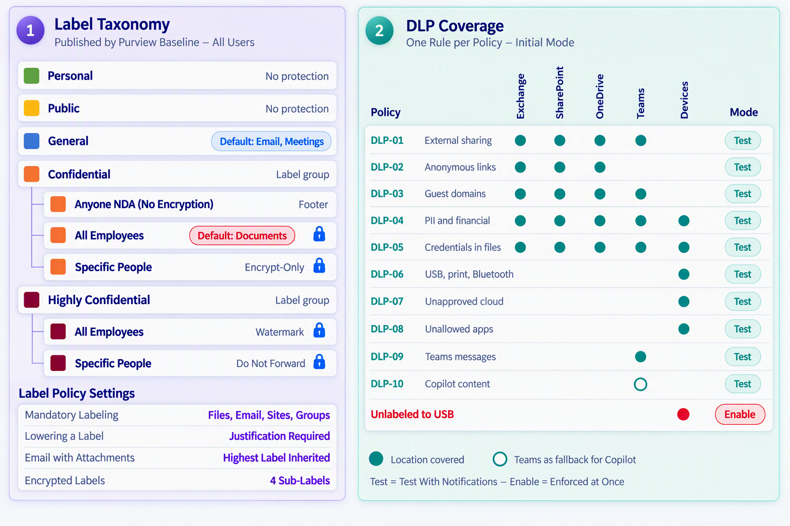

# Secure Purview Baseline Starter Kit

## Overview

The Secure Purview Baseline Starter Kit is an implementation-ready framework designed to accelerate the deployment of Microsoft Purview information protection and data loss prevention capabilities. It provides a practical starting point for organizations that want to establish a secure-by-default data protection posture across Microsoft 365 while minimizing initial design effort and reducing implementation complexity.

For implementation details, follow the guide here: [Secure Purview Starter Kit Implementation Guide](https://github.com/AzFrameworks/SecurePurviewBaseline/blob/main/Purview%20Starter%20Kit%20-%20Layered%20Implementation%20Guide%20-%20Beginner%20Edition.pdf)

The Starter Kit combines sensitivity labels, Data Loss Prevention (DLP), Endpoint DLP, Message Encryption, Insider Risk Management, and Adaptive Protection into a single coherent baseline. Rather than requiring organizations to design every control from first principles, the framework provides a validated foundation that can be tested, refined, and extended to meet individual business, regulatory, and compliance requirements.

The objective is not to provide a final production design, but instead to establish a well-structured baseline from which organizations can begin their Microsoft Purview journey with confidence.

# Design Philosophy

The Secure Purview Baseline Starter Kit is built around the Microsoft "Secure by Default" principle. Traditional information protection programs often begin with limited protection and gradually introduce more controls over time. This approach places the burden of classification and protection decisions on end users and frequently results in inconsistent protection levels across the organization.

The Starter Kit takes the opposite approach. Protection is applied by default and users are guided through the process of working with protected information. Classification becomes the standard operating model rather than an exception. This significantly reduces the likelihood of sensitive information remaining unprotected while creating a more predictable user experience.

The framework also emphasizes operational simplicity. Wherever possible, a single policy, a single taxonomy, and a single governance model are preferred over multiple overlapping configurations. This reduces administrative overhead, simplifies troubleshooting, and makes future expansion easier.

# Solution Architecture

The Secure Purview Baseline Starter Kit is composed of five foundational layers.

The first layer focuses on platform enablement. Microsoft 365 services such as SharePoint Online, OneDrive for Business, Exchange Online, and Microsoft Teams are prepared to support sensitivity labels and information protection features. This ensures that protection mechanisms operate consistently across workloads.

The second layer introduces a standardized sensitivity label taxonomy. Labels provide a common language for classifying information and become the foundation for encryption, access control, and policy enforcement throughout the platform.

The third layer establishes organization-wide publishing policies that deliver a consistent user experience. Users receive the same classification options regardless of workload while mandatory labeling and default labels ensure that content is protected from creation onward.

The fourth layer delivers Data Loss Prevention capabilities across Microsoft 365 workloads and managed endpoints. These controls help prevent accidental or intentional disclosure of sensitive information through sharing, messaging, printing, removable media, cloud applications, and other common exfiltration channels.

The final layer introduces risk-aware protection through Insider Risk Management and Adaptive Protection. These capabilities allow security controls to adapt dynamically based on user behavior and organizational risk indicators.

# Sensitivity Label Strategy

The Starter Kit implements a streamlined sensitivity label taxonomy that reflects common enterprise requirements while remaining simple enough for broad adoption.

The taxonomy is built around five primary classifications:

| Classification | Purpose |
|---------------|----------|
| Personal | Personal information and individual content |
| Public | Information approved for public distribution |
| General | Standard business information |
| Confidential | Sensitive organizational information |
| Highly Confidential | Information requiring the highest level of protection |

The Confidential and Highly Confidential classifications contain additional sublabels that support common collaboration scenarios, including internal sharing, named-recipient access control, and approved external collaboration arrangements.

A key design principle of the taxonomy is that all Highly Confidential content remains encrypted. Unlike some traditional taxonomies, no unencrypted Highly Confidential option exists. This ensures that the highest value information remains protected regardless of where it is stored or shared.

The taxonomy is intentionally compact. Experience has shown that excessive numbers of labels often create user confusion while delivering little additional security value. The Starter Kit focuses on a practical balance between security, usability, and operational consistency.

# Label Publishing and User Experience

The baseline adopts a single organization-wide publishing policy. Every user receives the same classification choices, the same default labels, and the same protection experience.

Documents automatically receive a Confidential classification by default, ensuring that business content begins its lifecycle protected. Email messages and meetings use a General classification as the default because collaboration scenarios typically require lower friction while still maintaining visibility of organizational classification requirements.

Mandatory labeling is enabled throughout the environment. Users are required to classify content before it can be saved or shared, helping organizations build a culture of information protection. If a user attempts to lower the sensitivity of content, a business justification is required. This creates accountability while generating audit records that can support compliance and investigation activities.

By maintaining a single publishing model across all workloads, the baseline minimizes administrative complexity and avoids the inconsistent user experiences that often emerge when multiple overlapping policies are introduced.

# Data Loss Prevention Strategy

The DLP component of the Starter Kit is designed around what is commonly referred to as the "80 percent ruleset". Rather than attempting to address every conceivable data protection scenario, the baseline focuses on the risks that most organizations encounter during the early phases of a Microsoft Purview deployment.

The controls address external sharing, anonymous access, unauthorized guest collaboration, exposure of regulated personal information, financial information, credentials, endpoint transfers, cloud application usage, sensitive Teams conversations, and Copilot-related content handling.

Most policies are initially deployed in monitoring mode with user notifications enabled. This allows security teams to observe policy behaviour, evaluate false positives, and understand potential business impact before enforcement actions are introduced. The approach enables organizations to tune thresholds, exceptions, and user experience settings using real operational data rather than assumptions.

The framework deliberately reserves organization-specific decisions such as approved partner domains, exception handling, incident ownership, and regulatory customization for later implementation phases.

# Endpoint Data Loss Prevention

Information protection requirements increasingly extend beyond cloud workloads and into endpoint devices. For this reason, Endpoint DLP forms a significant part of the baseline.

The Starter Kit provides controls to help prevent sensitive information from being transferred through removable media, Bluetooth devices, network locations, cloud services, and unapproved applications. These controls help extend Microsoft Purview protections to user devices while maintaining visibility and governance across data movement activities.

A particularly important safeguard within the baseline prevents unlabeled files from being copied to removable media. Because the rule relies on the easily understood condition of "unlabeled content," it can typically be enabled immediately while broader DLP policies remain in monitoring mode.

Successful Endpoint DLP deployment requires device onboarding, policy validation, approved application definitions, cloud destination configuration, and operational monitoring. These activities remain part of the organization's implementation responsibilities following deployment.

# Message Encryption

Message Encryption is integrated directly into the sensitivity label architecture. Rather than presenting users with a separate encryption platform, the experience is delivered through classification labels that automatically apply the required protection settings.

When encrypted labels are selected, access rights are enforced through Microsoft Purview Information Protection technologies. Users can collaborate with internal and external recipients while maintaining control over access to protected content.

The baseline provides secure collaboration patterns for named recipients and highly sensitive communications while leaving branding, legal disclaimers, and specialized encryption templates for later business-specific customization.

# Insider Risk Management and Adaptive Protection

The Starter Kit introduces Insider Risk Management as an additional layer of protection that complements classification and DLP controls.

While sensitivity labels define the value of information and DLP governs its movement, Insider Risk Management focuses on user behaviour. The baseline includes foundational policy scenarios that help organizations identify potential data leakage activities, investigate risks associated with departing employees, and apply additional scrutiny to high-impact users.

Adaptive Protection extends this capability by connecting risk signals directly to preventive controls. Endpoint restrictions can be strengthened automatically when users reach elevated risk levels, providing additional safeguards without requiring administrators to manually reconfigure policies.

This combination enables organizations to move beyond static information protection and toward a more context-aware protection model that incorporates both user actions and organizational risk indicators.

# Production Adoption Approach

The Secure Purview Baseline Starter Kit should be implemented using a phased validation methodology. All controls should initially be deployed within a non-production environment where behaviour, licensing requirements, protection outcomes, and operational impacts can be verified.

Once validated, organizations should review policy outcomes, analyze alert volumes, assess false positives, onboard endpoint devices, and complete all remaining tenant-specific configuration activities. Only after business stakeholders, security teams, compliance personnel, and operational owners have accepted the resulting behaviour should enforcement actions be introduced.

The Starter Kit is intended to accelerate adoption, not eliminate governance. Organizations remain responsible for validating the framework against their own legal, regulatory, privacy, and business requirements.

# Invitation to Contribute

The Secure Purview Baseline Starter Kit was developed to provide organizations with a practical, implementation-ready starting point for Microsoft Purview deployments. The framework, supporting scripts, and deployment logic have been tested across multiple Microsoft Purview laboratory environments and a variety of implementation scenarios.

While extensive testing has been performed, no baseline can anticipate every possible tenant configuration, licensing combination, integration dependency, regional variation, or operational requirement that may exist in real-world environments. As the Starter Kit is adopted by a wider audience, previously unidentified edge cases, configuration inconsistencies, or deployment challenges may emerge.

Community feedback is therefore highly encouraged and greatly appreciated.

If you encounter unexpected behaviour, deployment issues, inconsistencies, documentation gaps, or opportunities for improvement, please consider opening an issue or submitting a contribution. Feedback obtained through real-world deployments helps improve the reliability, accuracy, and operational value of the Starter Kit for all users.

Suggestions are equally welcome. Whether the recommendation relates to sensitivity labels, DLP controls, Endpoint DLP, Insider Risk Management, Adaptive Protection, deployment automation, documentation, or implementation guidance, constructive input helps ensure that the framework continues to evolve alongside Microsoft Purview capabilities and industry best practices.

The goal of this project is not only to provide a starting baseline, but also to foster a collaborative community effort that continuously improves the quality, usability, and effectiveness of the solution. Contributions of all sizes, from documentation corrections and bug reports to feature suggestions and code enhancements, are welcome.

Thank you for helping make the Secure Purview Baseline Starter Kit better for everyone.

# Disclaimer

The Secure Purview Baseline Starter Kit was authored by Daniel Metzger in an individual professional capacity. Although the author is an employee of Microsoft, this project is not an official Microsoft product, publication, support statement, commitment, or endorsement.

The content is based on publicly available Microsoft documentation, implementation experience, and independent research. It is provided for informational and planning purposes only and is subject to change as Microsoft products, services, licensing models, and technical capabilities evolve.

Organizations remain responsible for validating all configurations, scripts, recommendations, and deployment activities against current Microsoft documentation, licensing requirements, security requirements, privacy obligations, compliance mandates, and internal governance standards before implementation.

The Secure Purview Baseline Starter Kit should be tested in a non-production environment and reviewed by appropriately authorized technical, security, compliance, privacy, and legal stakeholders before production deployment.

Neither the author nor Microsoft accepts responsibility for loss, damage, service interruption, compliance outcomes, security incidents, or other consequences resulting from the use, modification, or interpretation of this material.

# Change Log

## Version 1.0 – Initial Release
**Release Date:** 26 July 2026

This release represents the initial public version of the Secure Purview Baseline Starter Kit.

### Included in this Release

- Initial sensitivity label taxonomy based on a secure-by-default design approach.
- Organization-wide label publishing policy with mandatory labeling, default labels, and downgrade justification.
- Baseline Microsoft Purview Data Loss Prevention (DLP) framework covering common information protection scenarios.
- Endpoint DLP baseline including protection for removable media, cloud uploads, and unmanaged applications.
- Unlabeled-to-USB protection policy enabled by default.
- Microsoft Purview Message Encryption integration for encrypted sensitivity labels.
- Insider Risk Management baseline consisting of Data Leaks, Data Theft by Departing Users, and Priority User monitoring scenarios.
- Adaptive Protection integration for risk-based endpoint control enforcement.
- Automated tenant enablement and platform preparation capabilities where supported by licensing and available management interfaces.
- Comprehensive deployment documentation and implementation guidance.

### Release Notes

Version 1.0 establishes the foundational architecture and deployment model for the Secure Purview Baseline Starter Kit. The objective of this initial release is to provide organizations with a practical starting point for Microsoft Purview adoption while reducing implementation complexity and accelerating time to value.

Future releases will incorporate community feedback, operational lessons learned, platform enhancements, documentation improvements, and support for newly available Microsoft Purview capabilities.

## Version 1.1 – Endpoint Protection Extension
**Release Date:** 14 November 2026

This release makes it easier to extend the Secure Purview Baseline Starter Kit from the initial Purview foundation to endpoint protection.

### Added in this Release

- Added three new scripts to automate Endpoint DLP configuration.
- Simplified the transition from the initial Purview baseline to endpoint protection.
- Reduced manual configuration steps for administrators.
- Improved deployment consistency by automating repeatable Endpoint DLP tasks.
- Made the Endpoint DLP implementation layer easier to deploy, validate, and maintain.
